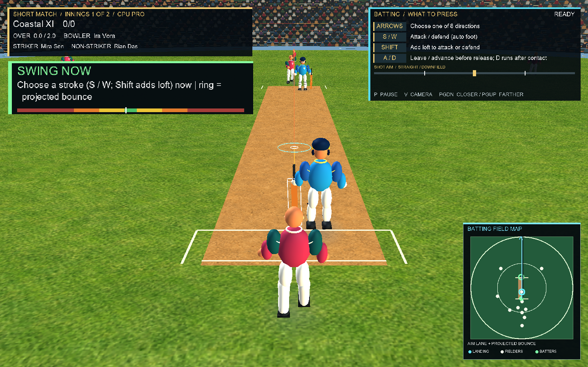

# Step 127 — Timing gauge and feedback channels

## Behaviour

- The live gauge is built from the current `TimingWindow` and the ball's distance to the adjusted contact plane. It draws seven contiguous color bands; the white marker moves toward the Ideal band as the ball approaches. The Ideal band follows difficulty, stroke rating, and the batter's settling history, and the gauge is hidden at Legend.
- On shot commit, a small screen inset is anchored above the striker for one second. It labels the resolved zone `VERY EARLY`, `EARLY`, `PERFECT`, `LATE`, `VERY LATE`, or `BEATEN`. The result card uses the same resolved label.
- Match-event subscribers play a centered contact sound for Ideal timing, thin contact sound for the edge zones, and a muted beaten cue for missed timing. Body hits use a low thud. GamePad feedback has strong short Ideal vibration, pulsed edge vibration, and a longer body-hit vibration.
- Boundary, wide, no-ball, and dismissal events show readable umpire signal banners: `FOUR`, `SIX`, `WIDE`, `NO BALL`, or `OUT`. The event bus now records the wide/no-ball signal explicitly.
- Presenter models and mappings stay graphics-free. `Game1.FeedbackHud.cs` draws the gauge and inset; a capture-only preview seeds a settled batter and stops the ball in the Ideal band.

## Capture

1440×900 Pro timing-gauge preview, with the settled batter's Ideal band visible:

## Files

- `src/SuperCricket.Game/Game1.BattingTiming.cs`
- `src/SuperCricket.Game/Game1.ContentLifecycle.cs`
- `src/SuperCricket.Game/Game1.Feedback.cs`
- `src/SuperCricket.Game/Game1.FeedbackHud.cs`
- `src/SuperCricket.Game/Game1.FeedbackMap.cs`
- `src/SuperCricket.Game/Game1.MatchActions.cs`
- `src/SuperCricket.Game/Game1.MatchFeedbackEvents.cs`
- `src/SuperCricket.Game/Game1.MatchLifecycle.cs`
- `src/SuperCricket.Game/Game1.MatchLoop.cs`
- `src/SuperCricket.Game/Game1.Rendering.cs`
- `src/SuperCricket.Game/Game1.cs`
- `src/SuperCricket.Game/MatchHudPresenter.cs`
- `src/SuperCricket.Game/Program.cs`
- `src/SuperCricket.Simulation/Events/MatchEvent.cs`
- `src/SuperCricket.Simulation/Events/MatchEventBus.cs`
- `src/SuperCricket.Simulation/PhysicsAutomatedMatchBatchSimulator.cs`
- `src/SuperCricket.Simulation/ProceduralCricketAudio.cs`
- `tests/SuperCricket.Game.Tests/MatchHudPresenterTests.cs`
- `tests/SuperCricket.Simulation.Tests/MatchEventBusTests.cs`
- `tests/SuperCricket.Simulation.Tests/ProceduralCricketAudioReviewChecks.cs`
- `docs/build/a5-build-plan.md`
- `docs/steps/captures/step-127-timing-gauge.png`

## Verification

- `dotnet build -c Release` — passed with 0 warnings and 0 errors.
- `dotnet test -c Release --no-restore` — passed: 287 Simulation, 179 Game, and 25 Content tests (491 total).
- `dotnet run --project src/SuperCricket.Game -c Release --no-build -- --verify-gameplay` — passed, including difficulty/settling gauge checks, Legend visibility, and commit feedback.
- `pwsh tools/review.ps1 -RunGameChecks` — passed, including deterministic physics batches, asset validation, batting analysis, gameplay checks, and 30 replayed live CPU traces.
- Presenter tests cover seven-band layout and progression, Ideal-band width, all seven label/audio zones, umpire signal mappings, gamepad feedback profiles, live banner content, and inset bounds.
- Capture command: `dotnet run --project src/SuperCricket.Game -c Release --no-build -- --capture-frame docs/steps/captures/step-127-timing-gauge.png --timing-gauge-preview`.

## Playtest checklist

- Compare the gauge's Ideal width at Rookie, Pro, and after the striker has faced several balls.
- Confirm the inset reports each timing label near the striker and fades after about one second.
- Try Ideal and edge contacts with a GamePad; confirm short strong and pulsed feedback differ, and verify a body-hit cue once body contact is live.
- Trigger four, six, wide, no-ball, and wicket results; confirm each umpire banner.

## Open questions

- None for this work package. Human feel and connected-device feedback remain part of the wave 3 playtest gate.
