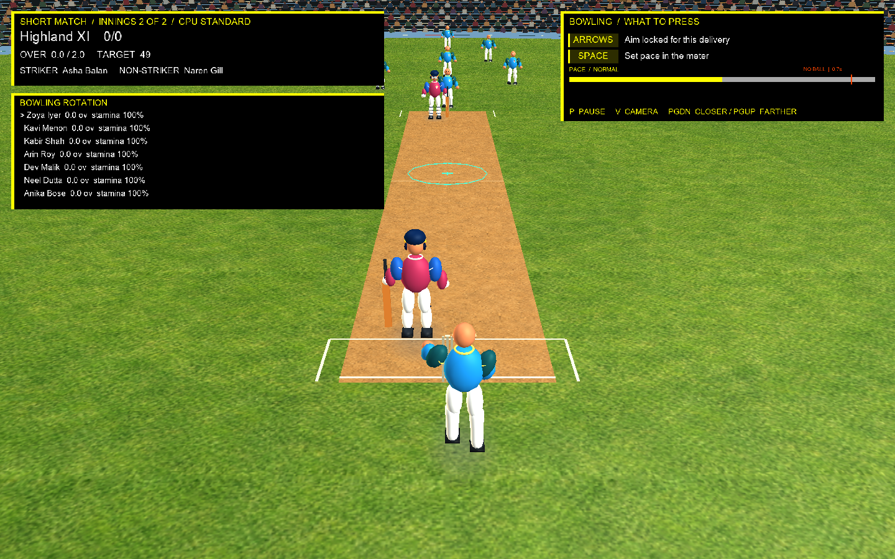

# Step 128 — Bowling controls and stride meter

## Behaviour

- The human bowler gets the catalogue entries matching the active bowler's style. Keyboard keys 1–8 select a delivery; GamePad A/X/Y/B select four at a time, with LB/RB changing pages. Selecting a delivery commits the current pitch target and starts the run-up immediately. Arrows and the D-pad move the target before selection.
- The target ring shows the accuracy radius and shrinks through the run-up. Space or the right trigger records the stride press; the meter resolves Slow, Normal, Fast, or a front-foot `NO BALL`. A missed press uses Normal pace.
- CPU deliveries preserve the CPU decision model's seeded target and accuracy variation, then use `BowlingAccuracyModel` for target radius and stamina response. Human catalogue deliveries use the same model for the intended target, scatter, rhythm, and stamina.
- The bowling HUD lists every bowler's completed overs and stamina, highlighting the current bowler. Stamina uses `StaminaAfterOvers` and updates as over rotation advances.
- `DeliverySession.SignalNoBall` applies a late front-foot call before contact resolution so it is not counted as a legal ball. A capture-only preview prepares the second innings and shows the live bowling controls and meter.

## Capture

1440×900 stride-meter preview with a Normal pace press and the no-ball threshold visible:

## Files

- `src/SuperCricket.Game/MatchController.cs`
- `src/SuperCricket.Game/MatchInputRouter.cs`
- `src/SuperCricket.Game/Game1.MatchActions.cs`
- `src/SuperCricket.Game/Game1.MatchLoop.cs`
- `src/SuperCricket.Game/Game1.MatchLifecycle.cs`
- `src/SuperCricket.Game/Game1.ContentLifecycle.cs`
- `src/SuperCricket.Game/Game1.ActionHud.cs`
- `src/SuperCricket.Game/Game1.Rendering.cs`
- `src/SuperCricket.Game/MatchHudPresenter.cs`
- `src/SuperCricket.Game/Program.cs`
- `src/SuperCricket.Simulation/LimitedOversMatch.cs`
- `src/SuperCricket.Simulation/DeliverySession.cs`
- `src/SuperCricket.Simulation/Bowling/BowlingAccuracyModel.cs`
- `src/SuperCricket.Game/SuperCricket.Game.csproj`
- `tests/SuperCricket.Game.Tests/MatchInputRouterTests.cs`
- `tests/SuperCricket.Game.Tests/MatchHudPresenterTests.cs`
- `tests/SuperCricket.Game.Tests/MatchControllerBowlingTests.cs`
- `tests/SuperCricket.Simulation.Tests/LimitedOversMatchReviewChecks.cs`
- `tests/SuperCricket.Simulation.Tests/IncomingDeliveryTests.cs`
- `src/SuperCricket.Game/LiveMatchReviewChecks.cs`
- `docs/build/a5-build-plan.md`
- `docs/steps/captures/step-128-bowling-meter.png`

## Verification

- `dotnet build -c Release` — passed with 0 warnings and 0 errors.
- `dotnet test -c Release` — passed: 288 Simulation, 188 Game, and 25 Content tests (501 total).
- Gameplay review checks passed, including the one-step human selector, stride timing, accuracy-model landing, and no-ball scoring without advancing a legal ball.
- `dotnet run --project src/SuperCricket.Game -c Release --no-build -- --verify-live-match artifacts/live-match-review.csv` — passed; 30 seeded live traces replayed identically across difficulty, frame rate, and match scenarios.
- Capture command: `dotnet run --project src/SuperCricket.Game -c Release --no-build -- --capture-frame docs/steps/captures/step-128-bowling-meter.png --bowling-meter-preview`.
- The 1440×900 capture was inspected for meter, target ring, control prompt, and bowler-list layout.

## Playtest checklist

- Select each delivery with keys 1–8; verify GamePad paging and A/X/Y/B selection for pace and spin bowlers.
- Move the target with arrows or the D-pad, select a delivery, and confirm the target locks while the run-up starts.
- Press Space/right trigger at Slow, Normal, Fast, and the final 8%; verify the displayed `NO BALL` and that no-balls do not advance the legal-ball count.
- Complete several overs and check bowler rotation, overs figures, and stamina values.
